<div align="center">


<br />
<br />


# LUMORA

### Adaptive Learning, Built Around the Learner.

**An interactive engineering case study of Lumora: an adaptive learning platform that combines an explainable adaptive engine,<br />an AI tutor with retrieval-augmented generation, interpretable machine learning and a full-stack React + FastAPI + PostgreSQL/pgvector system.**

[**✦ View the live case study**](https://divyanshi12coder.github.io/lumora-adaptive-learning-case-study/) &nbsp;·&nbsp;
[**Lumora source code**](https://github.com/Divyanshi12coder/lumora-adaptive-learning) &nbsp;·&nbsp;
[**Architecture**](https://github.com/Divyanshi12coder/lumora-adaptive-learning/blob/main/docs/ARCHITECTURE.md) &nbsp;·&nbsp;
[**Model card**](https://github.com/Divyanshi12coder/lumora-adaptive-learning/blob/main/docs/MODEL_CARD.md)

[](https://github.com/Divyanshi12coder/lumora-adaptive-learning-case-study/actions/workflows/deploy.yml)

<br />


<br />


<sub>✦ &nbsp;B U I L T &nbsp; &amp; &nbsp; C R E A T E D &nbsp; B Y &nbsp; D I V Y A N S H I&nbsp; ✦</sub>

</div>

---

## About this repository

This repository holds **only the presentation layer**: a fast, static, interactive website that tells the story of Lumora and explains how it was engineered.
The application itself (backend, frontend, ML, RAG, database and deployment) lives in its own repository:

| | Repository | What's inside |
|---|---|---|
| 🧠 | [**lumora-adaptive-learning**](https://github.com/Divyanshi12coder/lumora-adaptive-learning) | The Lumora platform: FastAPI backend, React app, adaptive engine, AI tutor, RAG, ML, PostgreSQL + pgvector, Docker, CI |
| ✦ | **lumora-adaptive-learning-case-study** (this repo) | The recruiter-facing case-study website, its diagrams and this README |

The two repositories are independent: the case study needs no backend, no database and no API keys.

<div align="center">

```
┌──────────────────────────────────────────────────────────────┐
│                         WHY LUMORA?                          │
└──────────────────────────────────────────────────────────────┘
```

</div>

Most learning software teaches every learner the same way: the same pace, the same wall of text, the same hint repeated louder.
Lumora treats every answer, hint, skip and pause as a **learning signal**. An explainable engine turns those signals into a **teaching strategy**
(difficulty, explanation style, text density, hints, examples, pacing, number of answer choices, quiz length, review and tone), and every
lesson, quiz and AI-tutor reply follows it.

<p align="center"><b>Problem</b> &nbsp;→&nbsp; <b>Signals</b> &nbsp;→&nbsp; <b>Adaptive engine</b> &nbsp;→&nbsp; <b>Personalised experience</b></p>

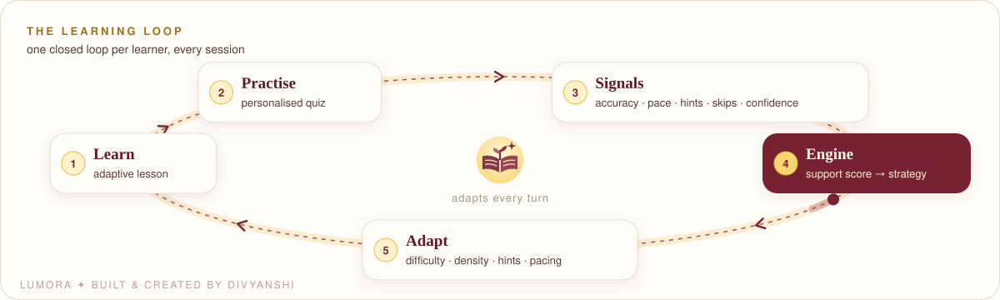

> Lumora is designed to support diverse learning preferences. **It is not a medical tool:** it does not diagnose, screen for or treat any
> condition, and its AI tutor declines to try.

## What Lumora does

<table>
<tr>
<td width="33%" valign="top">

**🧭 Adaptive learning**<br />
A pure, unit-tested engine weighs five signal families into a support score, then picks a teaching strategy and explains why.

</td>
<td width="33%" valign="top">

**📊 Learning intelligence**<br />
Accuracy, pace, hints, skips, confidence, mistake streaks and trends are tracked as events and turned into learner state.

</td>
<td width="33%" valign="top">

**💬 AI tutor "Divi"**<br />
Intent detection, the current strategy and retrieved lesson passages shape a schema-validated reply with cited sources.

</td>
</tr>
<tr>
<td valign="top">

**🔎 RAG**<br />
Heading-aware chunking, 384-dim embeddings, pgvector with an HNSW index, hybrid re-ranking and source references.

</td>
<td valign="top">

**📈 Interpretable ML**<br />
Bayesian Knowledge Tracing, a logistic-regression struggle model, a validated engagement model and descriptive clusters.

</td>
<td valign="top">

**🎯 Goals & progress**<br />
Learner-set goals, mastery rings, a learning journey and badges, with no streak pressure. A separate Insights view serves grown-ups.

</td>
</tr>
</table>

## The adaptive engine

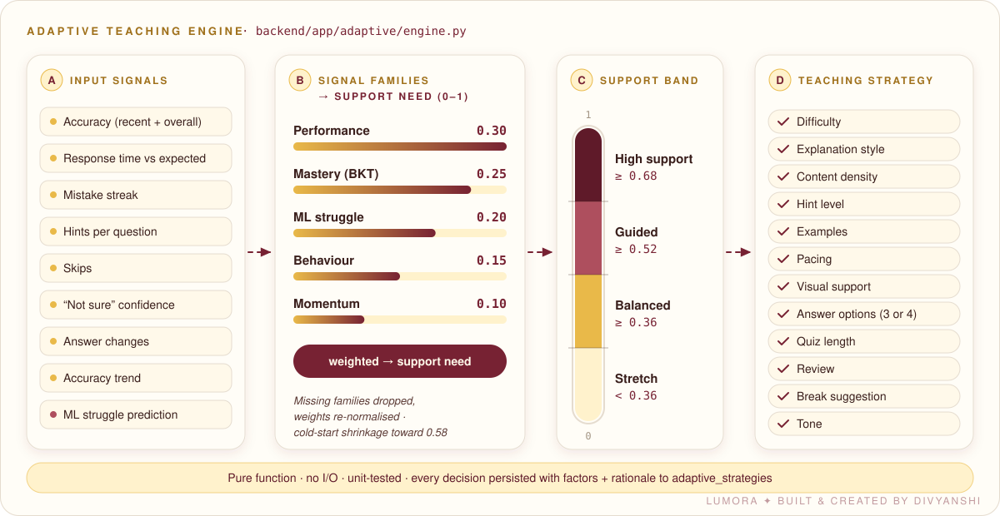

The engine (`backend/app/adaptive/engine.py` in the main repo) is a **pure function** with no I/O: `decide_strategy(signals, preferences) → TeachingStrategy`.

| Signal family | Weight | Support need is high when… |
|---|---|---|
| Performance | 0.30 | recent (65 %) and overall (35 %) accuracy are low |
| Mastery (BKT) | 0.25 | P(known) is low |
| ML struggle prediction | 0.20 | the model expects the next answer to be wrong |
| Behaviour | 0.15 | many hints, mistake streaks, skips, slow answers, "not sure" |
| Momentum | 0.10 | the accuracy trend is dipping |

Missing families are dropped and the weights re-normalised; with little data the score shrinks toward a gently supportive prior (0.58).
Every decision carries its factor contributions and a plain-language rationale, and is persisted for audit.

> **On the website**, the engine section runs a line-by-line **TypeScript port** of this engine, live in the browser. A parity test
> ([`src/test/engine.test.ts`](src/test/engine.test.ts)) checks it against golden outputs generated by the real Python engine.

## System architecture

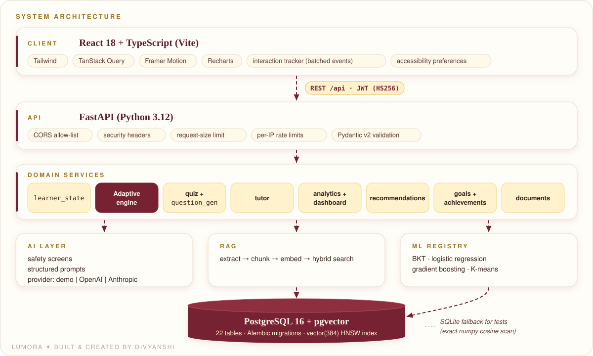

**In plain terms:** a web app in the browser talks to a Python API. The API's services decide how to teach, call the AI and search layers when
needed, and store everything in a PostgreSQL database that can also search by meaning.

**In technical terms:** React 18 + TypeScript (Vite, TanStack Query) → FastAPI with Pydantic v2, JWT auth, CORS, security headers and rate
limits → domain services (`learner_state`, engine, quiz, tutor, analytics, recommendations, goals, documents) → AI layer, RAG and an ML
registry → PostgreSQL 16 + pgvector (22 tables, Alembic migrations, HNSW index).

## AI layer

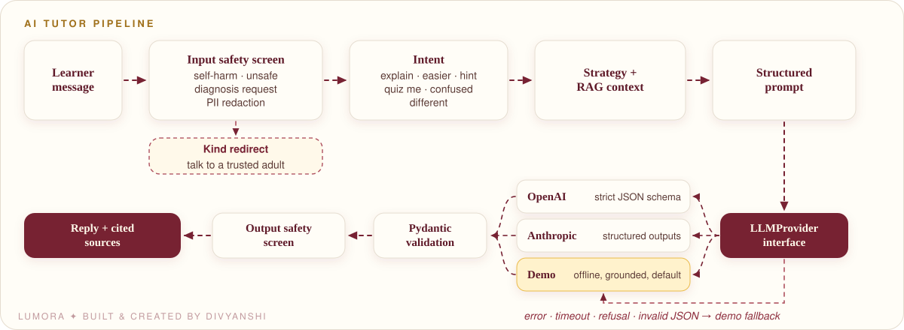

- **One provider interface:** `demo` (offline and grounded, the default), `openai` and `anthropic`. The real providers are integrated in code and switched on with an API key.
- **Structured outputs:** `TutorReply`, `GeneratedQuiz`, `DocumentSummary` and `StudyPlan` are Pydantic models, sent to providers as strict JSON schemas.
- **Never a crash for a child:** an error, timeout, refusal or invalid JSON falls back to a grounded demo answer, and the UI says so.

## RAG pipeline

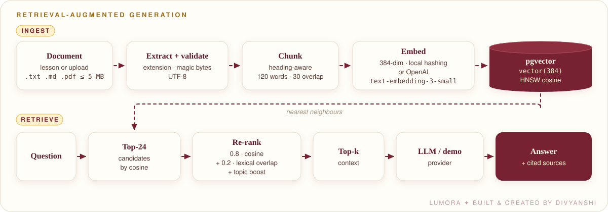

## Machine learning

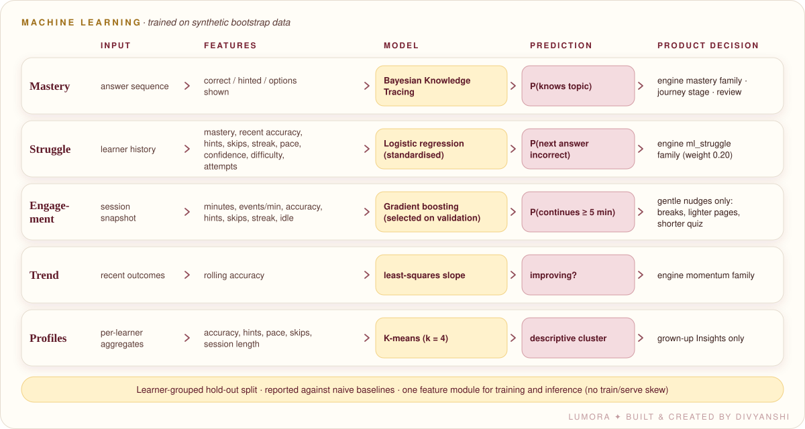

> **Synthetic/demo data is used for development and experimentation.** On a fresh install every model trains on a learner simulator. The
> results below validate the pipeline end to end; they are **not** real-world accuracy claims.

| Model | ROC-AUC | Brier (baseline) | Honest reading |
|---|---|---|---|
| Struggle (logistic regression) | 0.690 | 0.209 (0.233) | Modest, real lift over the baseline |
| Engagement (gradient boosting, selected on validation) | 0.573 | 0.242 (0.241) | Weak, so it is used only for gentle nudges |
| Profiles (K-means, k = 4) | silhouette 0.168 | – | Descriptive only; never shown to children |

## Data model

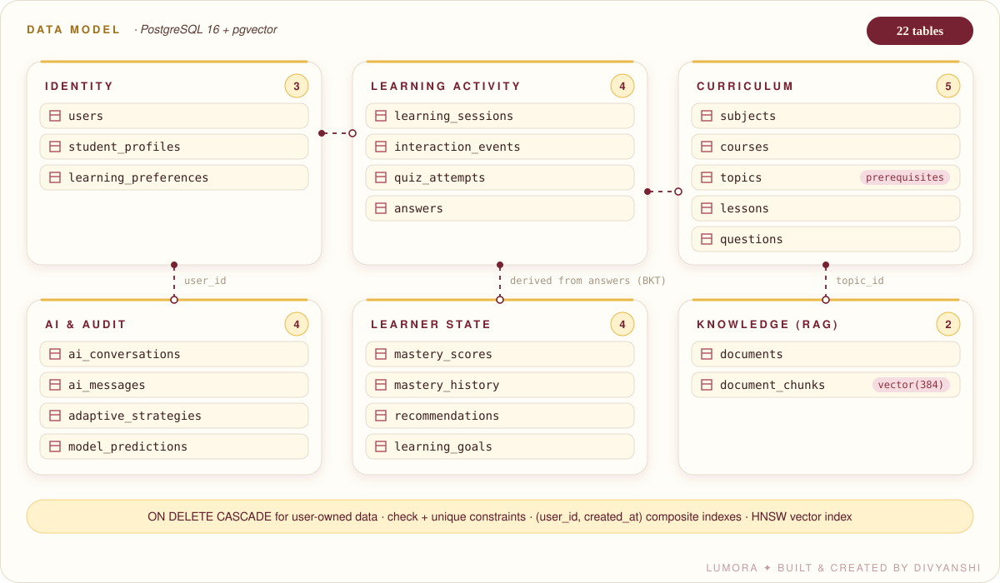

## Product screenshots

All screenshots are real captures of the running Lumora app. The demo account's practice history is **simulated**, and the app labels it as such.

| Learner dashboard | AI tutor with cited sources |
|---|---|
| 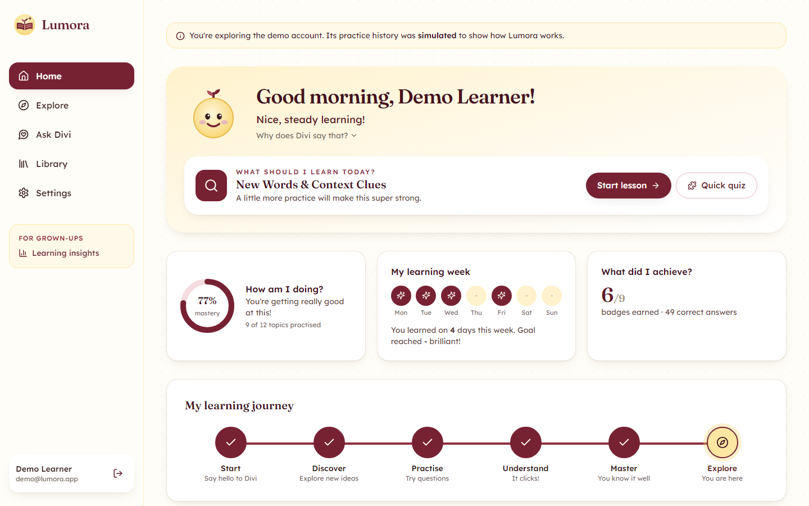 | 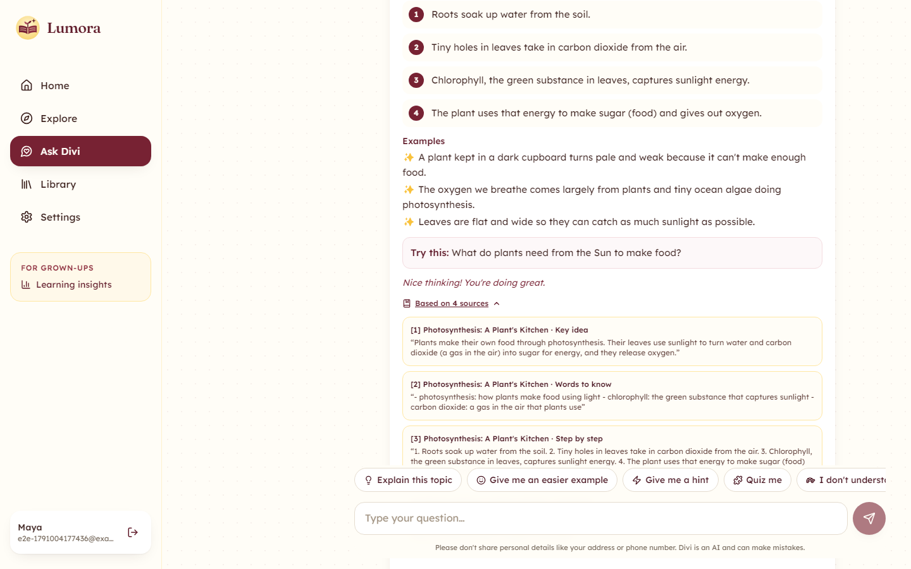 |
| **Grown-up Insights** | **RAG library search** |
| 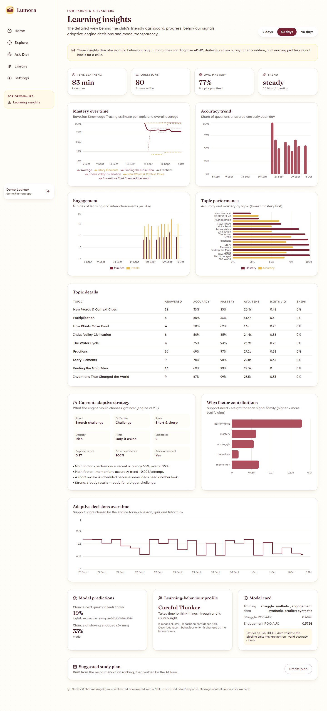 | 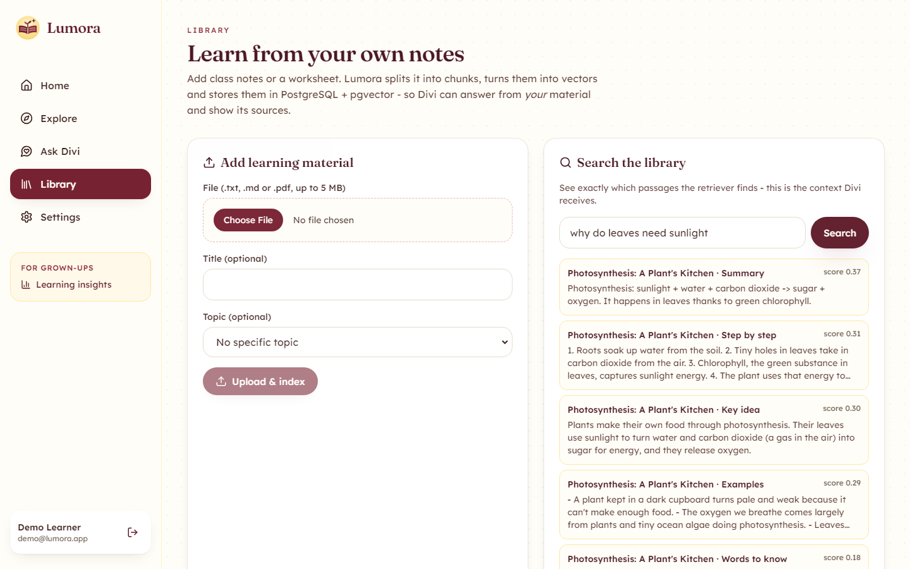 |
| **Quiz results and revision plan** | **Live engine demo** |
| 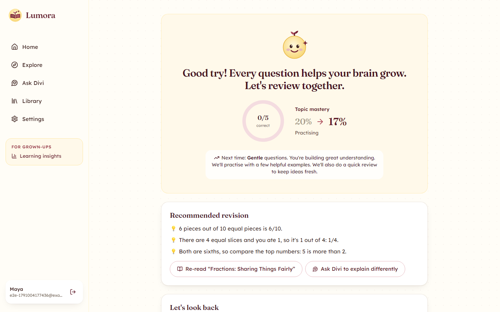 | 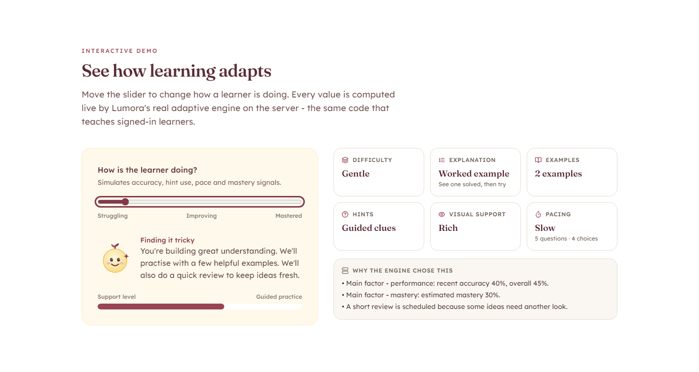 |

<details>
<summary><b>More: tutor demo, subjects, accessibility settings, phone</b></summary>

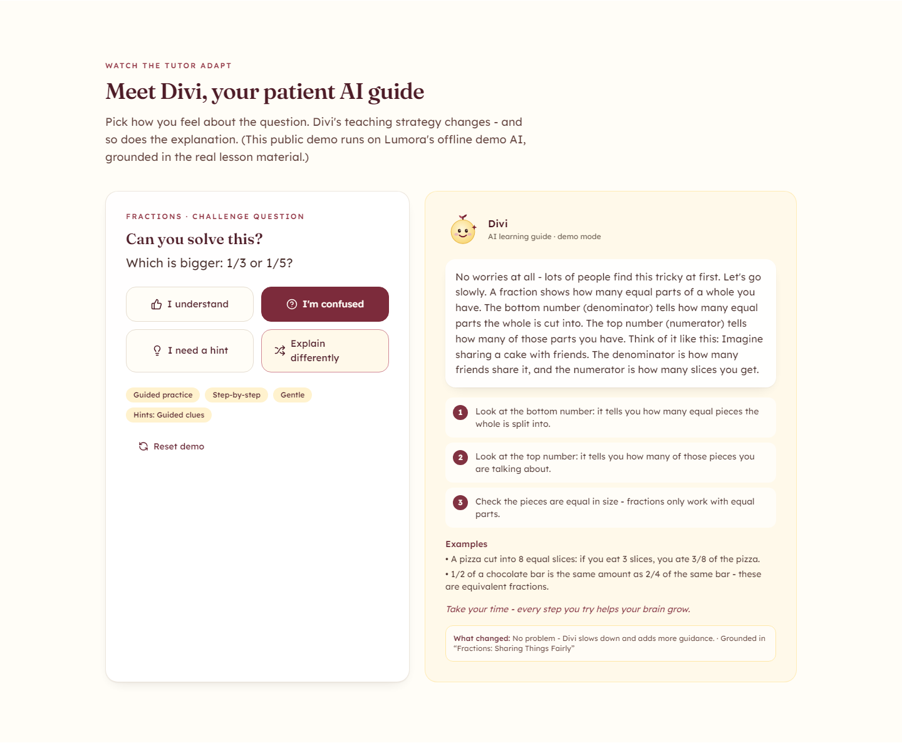
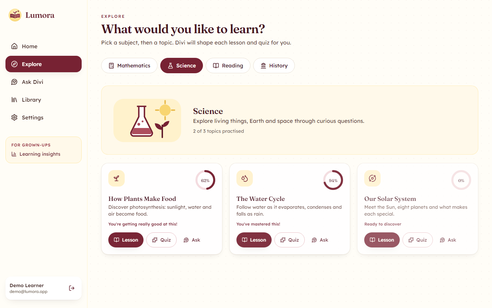
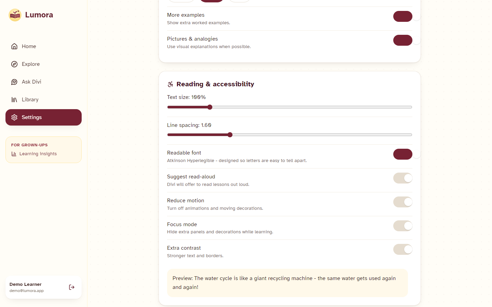

<p align="center">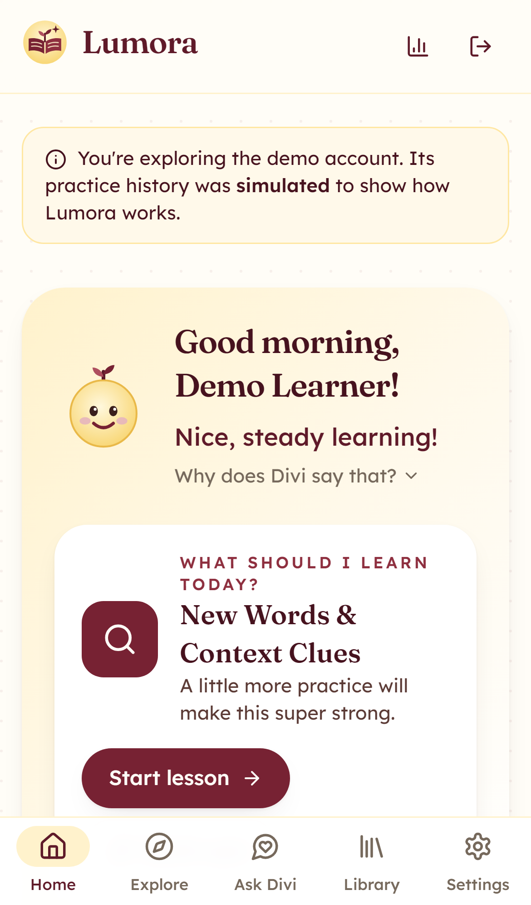</p>

</details>

## Deployment (Lumora platform)

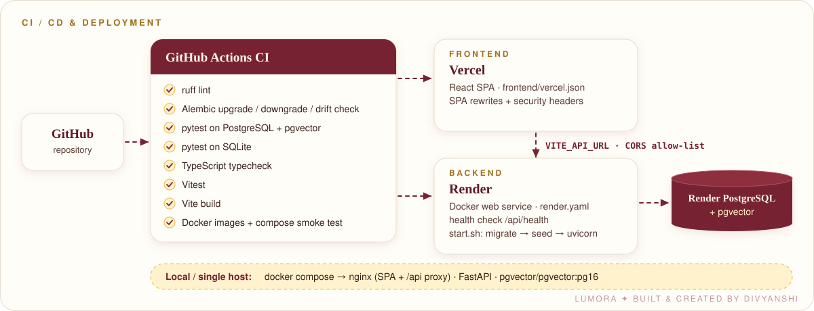

## Engineering highlights

| | Highlight | Evidence in the Lumora repo |
|---|---|---|
| ✅ | Full-stack architecture | React + TypeScript SPA, FastAPI API, PostgreSQL + pgvector |
| ✅ | Adaptive decision engine | Pure, weighted, explainable; every decision audited |
| ✅ | AI / LLM integration | Provider interface, structured outputs, safety screens, fallback |
| ✅ | RAG pipeline | Chunk → embed → HNSW search → hybrid re-rank → cited sources |
| ✅ | Machine learning | BKT, logistic regression, gradient boosting, K-means, against baselines |
| ✅ | Data modelling | 22 tables, Alembic migrations, cascades, constraints, composite indexes |
| ✅ | REST API design | 42 operations with OpenAPI docs at `/docs` |
| ✅ | Authentication & security | JWT with revocation, bcrypt, rate limits, security headers, upload validation |
| ✅ | Testing & CI | 89 backend tests on SQLite **and** PostgreSQL, 16 frontend tests, Docker smoke test |
| ✅ | Dockerised deployment | Docker Compose, Render blueprint, Vercel config |
| ✅ | Accessibility-focused UX | Keyboard, focus, contrast, readable font, read-aloud, reduced motion |
| ✅ | Responsible AI | No diagnosis, PII redaction, wellbeing responses, synthetic data labelled |

---

## The case-study website

**Live:** https://divyanshi12coder.github.io/lumora-adaptive-learning-case-study/

A 26-part story, from the problem to deployment, including:

- **An interactive engine lab:** move 13 signal sliders or pick a preset, and watch the support score, band gauge, factor contributions and all 12 strategy outputs update live.
- **An interactive architecture:** select a layer to see its responsibilities, technologies and source folder, with animated data flow.
- **A provider switcher** for the AI layer, an animated **RAG walkthrough**, **ML tabs** (input → features → model → prediction → decision), and a hoverable **data model**.
- **A product tour** of real screenshots in browser and phone frames, a **tech constellation**, flip-card **engineering challenges** and code excerpts with source links.

Every claim links to the code that backs it. Motion honours `prefers-reduced-motion`.

### Run locally

Requires Node 20 or newer.

```bash
git clone https://github.com/Divyanshi12coder/lumora-adaptive-learning-case-study.git
cd lumora-adaptive-learning-case-study
npm install
npm run dev          # http://localhost:5174
```

### Build, test and type-check

```bash
npm run build        # type-check + production build into dist/
npm run preview      # serve the production build locally
npm test             # Vitest: engine parity with Python + page behaviour (20 tests)
npm run typecheck    # strict TypeScript
```

### Environment variables

All are optional and read at build time. See [`.env.example`](.env.example).

| Variable | Purpose |
|---|---|
| `VITE_LIVE_DEMO_URL` | URL of a deployed Lumora app. When set, "Live demo" buttons appear; when empty, the site links to the deployment guide instead |
| `CASE_STUDY_BASE` | Base path for the build. The Pages workflow sets `/lumora-adaptive-learning-case-study/`; the default is `/` |

### Deploy

- **GitHub Pages (configured):** [`.github/workflows/deploy.yml`](.github/workflows/deploy.yml) tests, builds and publishes on every push to `main`.
  Enable it once under **Settings → Pages → Source: GitHub Actions**.
- **Vercel (alternative):** import the repo; [`vercel.json`](vercel.json) sets the Vite build, security headers and asset caching.

### Project structure

```
lumora-adaptive-learning-case-study/
├── src/
│   ├── components/      # Nav (active section, mobile menu), UI primitives, logo, frames
│   ├── sections/        # Hero, Story, Architecture, EngineLab, Intelligence, Product, Engineering, Closing
│   ├── lib/engine.ts    # TypeScript port of Lumora's adaptive engine
│   ├── data/            # links and screenshot imports
│   └── test/            # engine parity (golden outputs from Python) + page tests
├── public/              # favicon
├── docs/
│   ├── assets/          # logo, brand lockup, banner, diagrams, creator stamp, social image (SVG/PNG)
│   └── screenshots/     # real captures of the Lumora app
├── .github/workflows/   # test + build + deploy to GitHub Pages
├── index.html           # SEO, Open Graph and Twitter metadata
└── vite.config.ts · tailwind.config.js · tsconfig*.json · vercel.json
```

### Tech used for the site

React 18 · TypeScript (strict) · Vite 6 · Tailwind CSS · Framer Motion · Lucide icons · hand-authored SVG · Vitest + Testing Library.
No UI kits, no chart libraries, no images beyond real screenshots and custom SVG.

## Accessibility & responsible AI

- **Site:** semantic landmarks and headings, a skip link, visible focus, keyboard-operable tabs and controls, ARIA live regions for interactive
  explanations, 44 px touch targets, mobile layouts redesigned rather than shrunk, and reduced motion honoured everywhere.
- **Product:** learner-controlled text size, line spacing, readable font, read-aloud, focus mode, extra contrast and reduced motion, all fed to
  the adaptive engine. AI safety screens, PII redaction, no diagnosis, synthetic data labelled as synthetic.

## Roadmap (Lumora platform)

- [ ] Fit BKT parameters per skill with EM; explore deep knowledge tracing once real data exists
- [ ] Parent and teacher accounts with consent flows
- [ ] Provider moderation APIs and multilingual safety
- [ ] Semantic local embeddings and cross-encoder re-ranking
- [ ] Spaced-repetition scheduling and offline / PWA support
- [ ] A/B evaluation of engine weights against learning gains, with ethics review

## Contributing

Issues and suggestions are welcome. For changes to Lumora itself, open them on the
[main repository](https://github.com/Divyanshi12coder/lumora-adaptive-learning). For this site, fork, run `npm test && npm run build`, and open a pull request.

## License

[MIT](LICENSE)

---

<div align="center">


### Built & Created by Divyanshi

Lumora is an independent full-stack AI/ML project exploring how adaptive systems can make digital learning
more personalised, interpretable and accessible. Divyanshi designed and engineered it end to end:
product, UX, frontend, backend, AI, ML, RAG and DevOps.

[**GitHub · @Divyanshi12coder**](https://github.com/Divyanshi12coder) &nbsp;·&nbsp;
[**Lumora source**](https://github.com/Divyanshi12coder/lumora-adaptive-learning) &nbsp;·&nbsp;
[**Live case study**](https://divyanshi12coder.github.io/lumora-adaptive-learning-case-study/)

━━━━━━━━━━━━━━━━━━━━━━━━━━━━━━━━━━━━

**LUMORA**<br />
*Adaptive Learning, Built Around the Learner.*

✦ Built & Created by Divyanshi

━━━━━━━━━━━━━━━━━━━━━━━━━━━━━━━━━━━━

</div>
